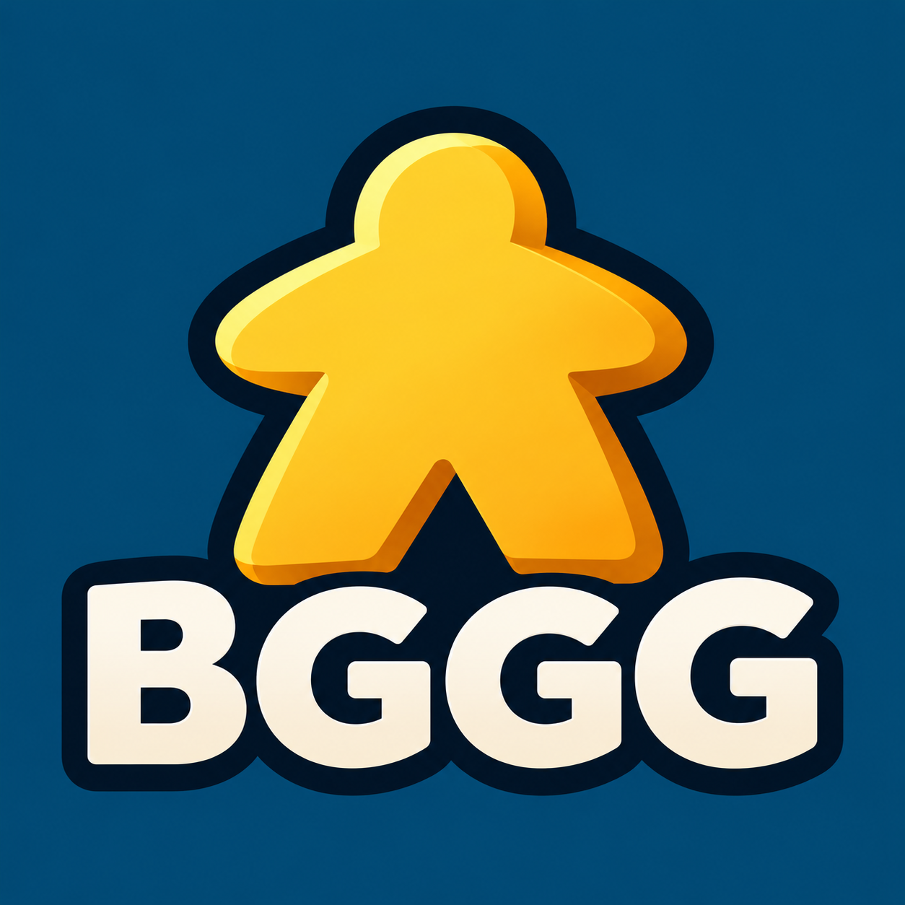
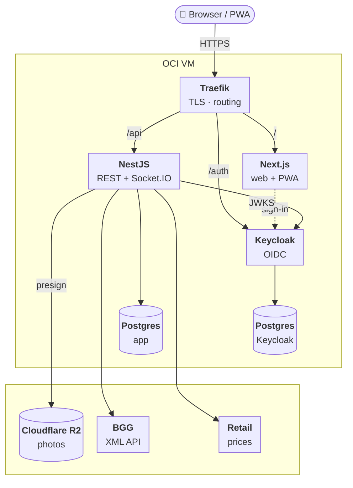
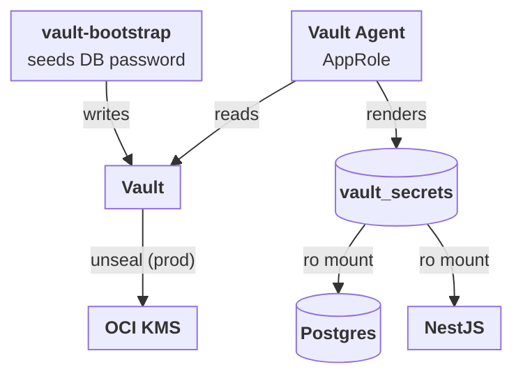
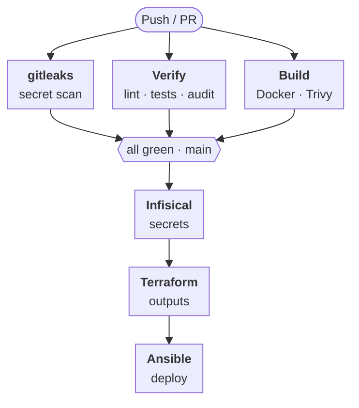

<p align="center">
  
</p>

<h1 align="center">BGGG — Board Game Group Platform</h1>

<p align="center">
  A self-hosted platform where a board-gaming group can share collections, schedule game nights, log plays and chat in one place.
</p>

---

## About

I built BGGG to solve a real problem for my own gaming group: who owns what, what we should play next, and when we can all get together. I also used it to learn the full lifecycle of a production system end to end: application code, infrastructure as code, CI/CD, secrets management and SecOps. The whole thing runs on Oracle Cloud's free tier.

The repo includes the learning trail behind the build. [`notes/`](notes/) has a write-up for every concept I learned along the way (Keycloak, Vault, Terraform, Traefik, OWASP and more). [`docs/superpowers/`](docs/superpowers/) has the design specs and implementation plans written before each larger feature, and [`design.md`](design.md) is the original product and architecture design.

## Features

- **Groups and invites**: invite-only groups with roles, per-group nicknames and expiring invite links/QR codes.
- **Game collections**: link a [BoardGameGeek](https://boardgamegeek.com) account to sync a collection, or add games by BGG ID. Includes wishlists, custom lists, private notes (price paid, date acquired) and a combined group library.
- **Collection statistics and pricing**: collection value analysis using BGG marketplace listings and retail prices.
- **Scheduling**: propose game nights, find overlapping availability, vote on games and venues, RSVP, then lock in a session.
- **Play logging**: record plays with scores, winners, guest players, notes and photos (uploaded straight to object storage with presigned URLs).
- **Reviews**: Markdown game reviews.
- **Real-time chat**: group, proposal and direct-message threads over WebSockets.
- **Calendar**: in-app month view plus a private, tokenised ICS feed for Google/Apple Calendar.
- **Installable PWA**: offline fallback, web push notifications with per-user preferences, and five switchable visual styles × light/dark themes.
- **Account lifecycle**: self-service account deletion with audit logging.

## Tech stack

| Layer | Technologies |
|---|---|
| **Frontend** | Next.js 16 (App Router), React 19, TypeScript, Tailwind CSS 4, Radix UI, Auth.js (NextAuth v5), Socket.IO client, next-pwa / Workbox, Web Push |
| **Backend** | NestJS 12, TypeORM, PostgreSQL 16, Socket.IO, `jose` (JWT/JWKS verification), class-validator, AWS SDK v3 (S3 API for R2) |
| **Identity** | Keycloak 26 (OIDC, custom login theme, service-account admin client) |
| **Secrets** | HashiCorp Vault (Agent-rendered secrets, AppRole auth, OCI KMS auto-unseal), Infisical (CI/deploy secrets) |
| **Edge** | Traefik v3 reverse proxy with automatic Let's Encrypt TLS, DuckDNS dynamic DNS |
| **Storage** | Cloudflare R2 (private bucket, short-lived presigned URLs) |
| **Infrastructure** | Terraform (OCI VCN, NSG, compute, KMS; Cloudflare R2; remote state in R2), Ansible (Docker, DuckDNS, app deploy roles) |
| **CI/CD** | GitHub Actions: gitleaks secret scanning, lint, unit and e2e tests, `npm audit` gate, Docker build, Trivy image scanning, automated deploy; Dependabot; scheduled image re-scans |
| **Dev experience** | Dev Containers, Docker Compose (dev/prod overlays), per-worktree isolated stacks, Jest and Testing Library (400+ tests) |

## Architecture

Everything except object storage and the external APIs runs on a single Oracle Cloud VM under Docker Compose.

### Runtime



### Secrets



### Request flow

1. **Traefik** terminates TLS and routes by path: `/auth` goes to Keycloak, `/api` and `/socket.io` go to the API, and everything else goes to the Next.js app.
2. **Authentication**: the web app signs users in through Keycloak with OIDC (Auth.js). Every API request and WebSocket handshake carries a bearer token. The API's `AuthGuard` verifies it against Keycloak's JWKS (RS256, issuer-checked) and rejects tokens from deleted accounts.
3. **Authorisation**: group membership and roles are checked in the service layer. Request bodies go through whitelisting DTO validation (`forbidNonWhitelisted`).
4. **Uploads** never pass through the API. The API checks membership and hands out a short-lived presigned URL, and the browser talks to R2 directly.
5. **Secrets**: no service reads a database password from an environment file. Vault Agent authenticates with AppRole and renders credentials to a shared volume that consuming containers mount read-only. In production, Vault unseals itself through OCI KMS.

### Delivery pipeline



## Repository layout

```text
apps/
  api/            NestJS API: feature modules, TypeORM entities and migrations
  web/            Next.js app: App Router pages, components, hooks, service worker
infra/
  terraform/      OCI network, compute and KMS; Cloudflare R2; remote-state bootstrap
  ansible/        Docker, DuckDNS and app-deploy roles plus deploy script
  keycloak/       Realm export, user-profile config, custom login theme
  vault/          Server/agent configs, policies, bootstrap scripts
  scripts/        Secret import and dev helpers
scripts/          Worktree-isolated dev environments, npm audit gate
docs/             Reference docs, feature specs and implementation plans
notes/            Learning notes, one per concept, in roadmap order
.devcontainer/    Reproducible development container
docker-compose*.yml   Base stack plus dev / prod overlays
```

## Running locally

**Prerequisites:** Docker, Node.js ≥ 22. A [Dev Container](.devcontainer/) config is included if you prefer that.

```bash
cp .env.example .env          # then replace the placeholder passwords
npm install
make deploy-dev               # Traefik, Postgres, Keycloak, Vault, API, web
make seed-user                # creates a throwaway dev login (user / user)
```

Then open <http://localhost:3000>.

To run the apps outside Docker against the containerised infrastructure, use `npm run dev:api` and `npm run dev:web`. To run several isolated stacks side by side (one per git worktree), see `make dev-setup`. `make help` lists every target.

### Tests

```bash
npm test --workspace=apps/api          # API unit tests
npm run test:e2e --workspace=apps/api  # API end-to-end tests
npm test --workspace=apps/web          # web component and hook tests
```

## Deployment

Production runs on a single Oracle Cloud free-tier VM:

1. `infra/terraform/bootstrap` creates the R2 bucket that holds Terraform state.
2. `infra/terraform` provisions the network, a locked-down NSG (SSH only from an allow-listed CIDR), the VM, the KMS key for Vault auto-unseal, and the R2 uploads bucket.
3. `infra/ansible/deploy.sh` pulls secrets from Infisical, reads the Terraform outputs, generates the inventory and runs the playbook. CI runs this same script on every merge to `main`.

Real credentials never live in the repo. `*.example` files show the expected shape of each config file.

## Security practices

- OIDC through Keycloak, with JWT signatures verified against JWKS on every request and socket connection
- Strict DTO validation and whitelisting on all inputs
- Secrets injected at runtime by Vault Agent and Infisical, never committed; the Vault server auto-unseals via KMS
- Private object storage, reachable only through short-lived presigned URLs issued after a membership check
- Audit log of security-relevant actions
- CI gates: full-history gitleaks secret scanning, `npm audit` (high/critical) and Trivy container scanning, plus scheduled re-scans of deployed images and Dependabot updates
- Network security group exposes only 80/443 publicly, with SSH limited to a single CIDR

## License

Copyright © 2026 Leonidas Delimpasis.

This program is free software: you can redistribute it and/or modify it under the terms of the [GNU Affero General Public License](LICENSE) as published by the Free Software Foundation, either version 3 of the License, or (at your option) any later version.

In short: you can use, study, modify and self-host BGGG. If you run a modified version as a network service, you must offer its source code to that service's users under the same license.

## Acknowledgements

Game data comes from the [BoardGameGeek XML API](https://boardgamegeek.com/wiki/page/BGG_XML_API2). This project is not affiliated with BoardGameGeek.
